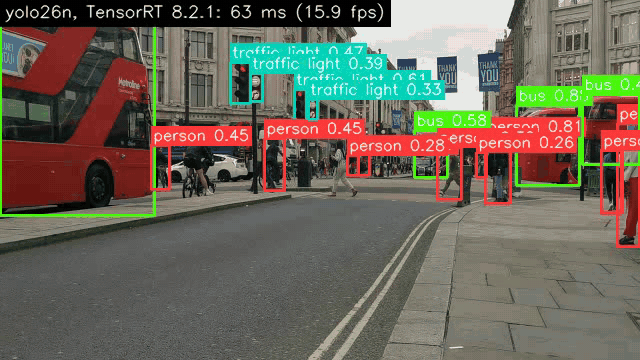
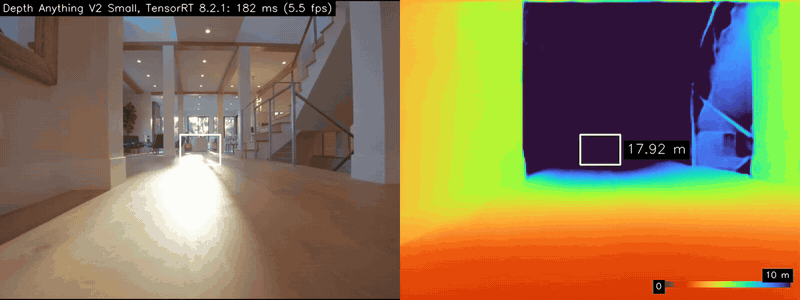
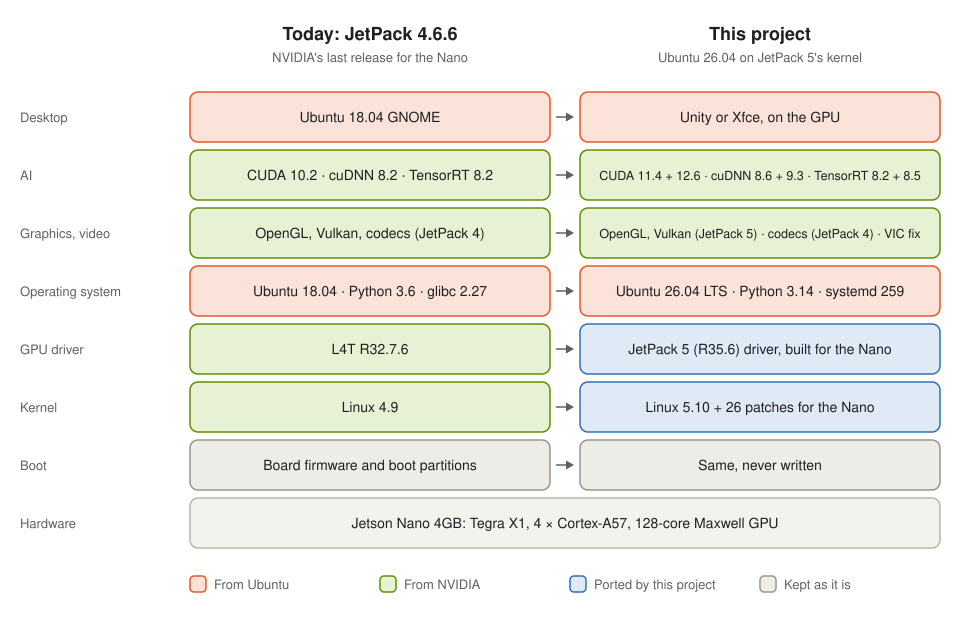
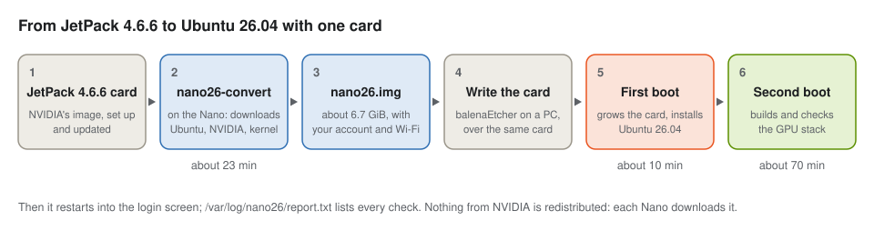

# Ubuntu 26.04 with CUDA on the Jetson Nano

[](https://github.com/igsova/jetson-nano-ubuntu-26/actions/workflows/checks.yml)

NVIDIA's last software for the original Jetson Nano is Ubuntu 18.04 on
Linux 4.9. This project runs **Ubuntu 26.04 LTS** on it with the GPU
working: NVIDIA's JetPack 5 kernel (Linux 5.10) ported to the Nano with 27
patches, CUDA 11.4 and 12.6, cuDNN, TensorRT, OpenGL, Vulkan and a desktop
on the GPU. A converter builds the system on your own Nano from Ubuntu's
and NVIDIA's downloads, and the board's boot firmware is never written.

**[Read the write-up](https://igsova.github.io/jetson-nano-ubuntu-26/)**:
the whole story with diagrams, from the first backup to the converter.





<sub>Both run on the Nano through TensorRT 8.2, every frame of a stock clip from
[Pexels](https://www.pexels.com) (`--video` in
[yolo-cam.py](scripts/jetson/yolo/yolo-cam.py) and
[depth-cam.py](scripts/jetson/yolo/depth-cam.py)); the GIFs play at the
clip's speed, and the time on each frame is the Nano's, timed as in the
live programs below.</sub>

| Live on a USB webcam, through TensorRT 8.2 | Pictures a second |
| --- | --- |
| Object detection: YOLO26n, 640x480, FP16 | 23.1 |
| Metric depth: Depth Anything V2 Metric Small, 336x252, FP16 | 5.5 |

## At a glance

| | |
| --- | --- |
| Board | Jetson Nano 4GB developer kit, B01 carrier (the only one tested) |
| From | JetPack 4.6.6: Ubuntu 18.04, Linux 4.9, CUDA 10.2 |
| To | Ubuntu 26.04.1 LTS with its own systemd, Linux 5.10.216, CUDA 11.4 and 12.6, TensorRT 8.2 and 8.5 |
| Kernel work | [27 patches](patches/jp5/README.md) (35 files, 1,523 lines added), a device tree and a config fragment, found over 39 numbered trials on the board |
| Safety | Only the microSD card changes. The boot firmware and eFuses are never written, and the hardware runs at JetPack 4's clocks and voltages. [Details](docs/SAFETY.md) |
| Status | Works on one Nano. The converter ran end to end once (2026-10-22); the kernel it downloads is not published yet |

## Why

NVIDIA's last release for the Nano, JetPack 4.6.6, is Ubuntu 18.04 on Linux
4.9 with CUDA 10.2, and much of today's software no longer runs there:

- **ROS 2.** Current releases install from apt only on newer Ubuntu (Humble
  on 22.04, Jazzy on 24.04, Lyrical on 26.04); on JetPack 4 they have to be
  built from source, usually in a container.
- **VS Code over SSH, Node.js.** Current releases of both need Linux 4.18
  and glibc 2.28; JetPack 4 has 4.9 and 2.27.
- **Docker.** Docker's current releases install only on Ubuntu 22.04 and
  newer; JetPack 4 keeps Ubuntu 18.04's older Docker package.
- **AI coding tools.** Claude Code, for one, needs Ubuntu 20.04 or newer.
- **Python.** 3.6, out of support since 2021, where 26.04 has 3.14; pip
  dropped 3.6 at version 22, and NumPy 2 needs 3.9 or newer.
- **Security updates.** Ubuntu 18.04's standard support ended in 2023;
  26.04's runs to 2031.
- **Ubuntu itself.** Ubuntu 26.04's systemd needs Linux 5.4 or newer, so it
  cannot start on JetPack 4's kernel.

Ubuntu 26.04 on a mainline kernel is no way out either: mainline Linux
drives the Nano's GPU only with the open nouveau driver, with no CUDA, cuDNN
or TensorRT. NVIDIA's GPU driver comes only with NVIDIA's kernels, and
JetPack 5, the first on Linux 5, was never released for the Nano. This
project ports JetPack 5's kernel and GPU driver to it.



## What works, and what does not

Works, each tested on the Nano:

- Ubuntu 26.04.1 LTS with its own systemd 259, on JetPack 5's 5.10 kernel
  with this project's patches.
- CUDA 11.4, with CUDA 12.6 beside it; cuDNN 8.6 and 9.3; TensorRT 8.2 (the
  default, faster on the Nano's GPU) and 8.5.
- OpenGL, OpenGL ES and Vulkan compute; Unity or Xfce on the GPU, over
  HDMI.
- Hardware video: H.264 and H.265 decoding and encoding and JPEG decoding,
  and NVIDIA's video converter (VIC), through JetPack 4's GStreamer
  elements (`nano-r32-video gst-launch-1.0 … nvv4l2decoder …`).
- USB 2 and 3, Wi-Fi through a USB adapter, a USB webcam with its
  microphone, the 5 W and MAXN power modes and the fan. The CPU, GPU and
  memory reach the same clock speeds as under JetPack 4.

Does not work yet, because it is switched off in the 5.10 device tree:

- The DisplayPort output.
- CSI cameras (the two camera connectors). USB cameras work.
- Audio from the board itself, HDMI's included. A USB microphone works.

Broken in NVIDIA's JetPack 5 libraries on this GPU, with JetPack 4's doing
the job instead:

- JetPack 5's H.264 encoder, which crashes. H.264 is encoded through
  JetPack 4's elements.
- JetPack 5's video converter on its GPU path (`compute-hw=GPU`), which
  writes flat frames. Its default path, the video engine, is correct. The
  converter's report shows this one as `gpu=FAIL`; nothing uses it.

Untested:

- Ethernet. Its driver loads, finds no hardware address and makes one up
  at each boot; no cable was ever connected.
- The 40-pin header (GPIO, I2C, SPI, serial data), 4K output and USB device
  mode.
- ROS 2 on the finished system. ROS 2 Lyrical from apt ran on this Nano
  under Ubuntu 26.04 at an earlier stage, still on the old kernel (talker
  and listener, `ros2 doctor` 5 of 5); it has not been installed again
  since the move to 5.10.
- Any other board: the A02 carrier, the 2GB Nano and the eMMC module. The
  converter refuses them.

## Is it safe?

The longer answer, with how to check each point yourself, is in
[docs/SAFETY.md](docs/SAFETY.md). In short:

- **Only the microSD card changes.** The boot firmware in the module's
  flash chip is never written, and neither are the chip's eFuses: no script
  here opens the flash, the kernel is built without the fuse-burning
  interface, and NVIDIA's packages that write the flash when installed are
  left out. A card that will not boot is fixed by writing NVIDIA's image to
  it again.
- **The hardware runs at NVIDIA's numbers.** The clock limits, voltage
  tables and memory timings are JetPack 4's. Nothing is overclocked, and no
  patch adds a number of its own.
- **Every download is checked** against a signature or a pinned SHA-256,
  and comes from its publisher: Ubuntu, NVIDIA, and this repository for
  the kernel, which you can also build yourself. Nothing of NVIDIA's is
  redistributed here, and the converter sends nothing anywhere.
- **It has run on one board.** Nobody but the author has converted a Nano
  yet. The chip's over-temperature throttling and shutdown were never
  tested under 5.10. The kernel, NVIDIA's libraries and the desktop's X
  server get no security updates; Ubuntu's own packages do.

Treat it as an experiment: use a card you can afford to rewrite, and
[back it up first](docs/BACKUP.md) if it holds anything you care about.

## Put it on your own Nano

**Not ready yet:** the converter ran on this project's Nano (2026-10-22),
from a JetPack 4.6.6 card to the desktop with every step passing, but the
kernel it downloads is not published yet.

You need a Jetson Nano 4GB on the B01 carrier board (two camera
connectors), one microSD card of 32 GB or more, a computer with a card
reader and [balenaEtcher](https://etcher.balena.io/), and internet, an HDMI
screen, keyboard and mouse on the Nano.

1. **JetPack 4.6.6.** Write NVIDIA's JetPack 4.6.1 SD card image
   ([JetPack archive](https://developer.nvidia.com/embedded/jetpack-archive))
   to the card, finish NVIDIA's setup on the Nano, and update it:

   ```bash
   sudo apt update && sudo apt dist-upgrade && sudo reboot
   head -1 /etc/nv_tegra_release    # R32 (release), REVISION: 7.6
   ```

2. **Build the image, on the Nano.** Copy this repository to the Nano. The
   dry run checks the board, JetPack and the free space, and shows the plan:

   ```bash
   cd jetson-nano-ubuntu-26/scripts/jetson/convert
   sudo ./nano26-convert --target-image ~/nano26.img --dry-run
   sudo ./nano26-convert --target-image ~/nano26.img
   ```

   It downloads Ubuntu 26.04, NVIDIA's packages (you accept NVIDIA's terms)
   and the kernel, and copies your account, SSH keys, hostname and Wi-Fi
   into a 6 GB image (estimate). The image holds your password hash, SSH
   keys and Wi-Fi passwords, so keep it to yourself. Until the kernel is
   published, add `--kernel DIR` with a kernel built by
   [build-jp5-kernel.sh](scripts/host/build-jp5-kernel.sh).

3. **Copy it to your computer:**

   ```bash
   scp 'USER@ADDRESS:nano26.img*' .
   sha256sum -c nano26.img.sha256
   ```

4. **Write it over the card.** `sudo poweroff` on the Nano, then write
   `nano26.img` to the card with balenaEtcher. This replaces JetPack.

5. **Start the Nano from it**, with the screen on. The first boot grows the
   system to the whole card and installs Ubuntu (about 10 minutes); the
   second builds and checks the GPU stack (about 70 minutes), then restarts
   into the login screen. `/var/log/nano26/report.txt` lists what passed.

To go back, write NVIDIA's image again (step 1). If `ssh` from a computer
with OpenSSH 10.1 or newer stops before the password prompt, add
`IPQoS none` for the Nano to `~/.ssh/config`: some networks lose the
priority marking newer OpenSSH puts on its packets.

## How it works



The converter runs on JetPack 4.6.6 and builds the new system as an image:
Ubuntu 26.04's base, the 5.10 kernel, NVIDIA's JetPack 4, 5 and 6 packages
and your settings, with NVIDIA's boot partitions copied as they are. On the
new card, the first boot installs Ubuntu's packages; the second repackages
NVIDIA's on the Nano and installs the parts that run on this kernel, then
checks CUDA, TensorRT, OpenGL ES, Vulkan and video before it shows the
desktop.

- [docs/ARCHITECTURE.md](docs/ARCHITECTURE.md): what runs on the finished
  system, which JetPack each piece comes from, and why it takes three.
- [docs/CONVERTER.md](docs/CONVERTER.md): the converter, step by step.

## The kernel port

JetPack 5's kernel source still holds the Tegra X1's drivers, but NVIDIA
never built or tested it for the Nano. The first boot hung on the boot
logo and the second stopped in a kernel panic. Thirty-nine numbered trials
later the Nano ran at JetPack 4's clock speeds with CUDA computing correct
results. That took 27 patches, a device tree
and a config fragment, and the problems were of three kinds:

- **Old libraries, new kernel** (7 patches). NVIDIA's closed libraries make
  numbered requests of the kernel with fixed binary layouts. Where JetPack
  5 changed or dropped one, a JetPack 4 library failed, often without a
  message.
- **Board support only finished for Linux 4.9** (14 patches). Memory stayed
  at its 204 MHz boot speed instead of 1,600, which made a CUDA test nine
  times slower; clocks refused to start; the video converter's firmware
  never ran.
- **Bugs nobody had hit** (5 patches), in code that never runs on NVIDIA's
  newer boards: a two-byte stack overflow that panics the boot, an IOMMU
  driver that leaves most of what it maps unflushed, USB 3 lanes never
  powered because of a name.

Each one was found the same way: change one thing, boot once, collect the
kernel log and the test results, and compare them with a boot of NVIDIA's
own kernel on the same card. [patches/jp5](patches/jp5/README.md) has a
table row for every patch (what went wrong, what the patch does, the trial
that showed it fixed), and each patch file opens with its own description.

## What is in this repository

| Folder | What it holds |
| --- | --- |
| [scripts/jetson/convert](scripts/jetson/convert) | The converter: stage 1, the first boot and stage 2 |
| [scripts/](scripts/README.md) | Everything else, by where it runs: on a converted Nano, on a PC (the kernel build, card backup and restore, model export), the two demos, and the probes used during the port |
| [patches/jp5](patches/jp5/README.md) | The kernel port: 27 patches, the device tree, the config fragment |
| [tests/](tests/README.md) | The converter's PC tests, and the small programs the checks run on the Nano (CUDA, OpenGL ES, Vulkan, TensorRT, video) |
| [docs/](docs) | [Architecture](docs/ARCHITECTURE.md), [the converter](docs/CONVERTER.md), [safety](docs/SAFETY.md), [card backup](docs/BACKUP.md), [references](docs/REFERENCES.md), and the [write-up](https://igsova.github.io/jetson-nano-ubuntu-26/) (`docs/index.html`, published with GitHub Pages) |

## How it was made

A hobby project on one Nano, in two weeks of October 2026. AI coding
assistants did much of the reading, building and bookkeeping, under
[written rules](AGENTS.md): nothing counts until it has passed on the real
board, one change per boot, and every result written down, failures
included. [patches/jp5/NOTES.md](patches/jp5/NOTES.md) is that record for
the kernel port.

## Licences

This repository is under the [MIT licence](LICENSE), except
[patches/](patches), which is GPL-2.0-only like the kernel it modifies (see
[patches/LICENSE](patches/LICENSE)). NVIDIA's software is not included: it
comes from NVIDIA to each Nano, under NVIDIA's terms; Ubuntu's comes from
Ubuntu's archive. There is no warranty: see [docs/SAFETY.md](docs/SAFETY.md).

## Thanks

[OE4T](https://github.com/OE4T), whose trees hold NVIDIA's kernel sources
in one place; NVIDIA's Jetson Linux; and Ubuntu.
