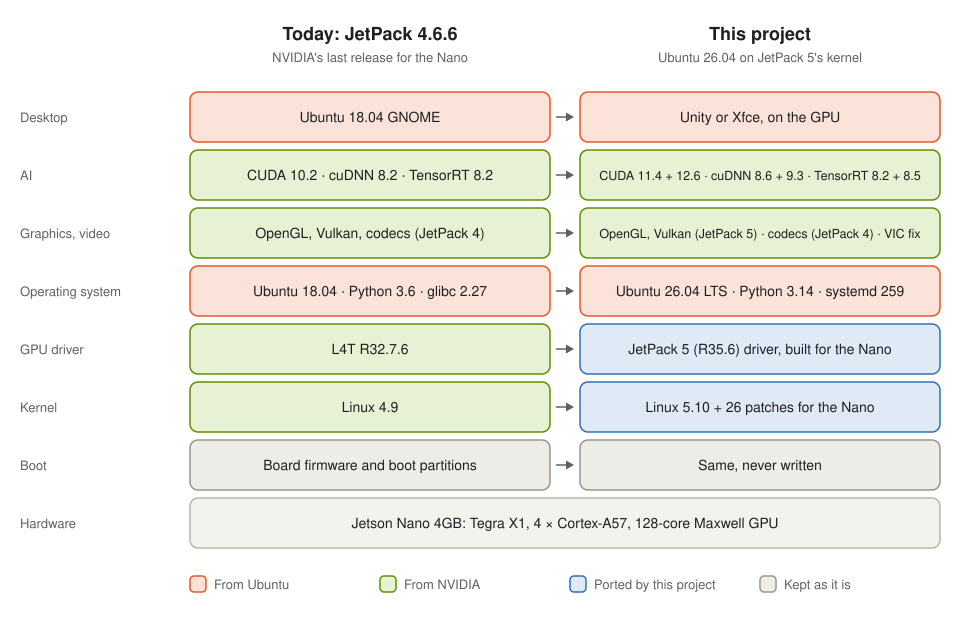

# How the system fits together

What runs on a converted Nano, where each piece comes from and why it was
chosen. The [converter's page](CONVERTER.md) says how the pieces get onto
the card, [patches/jp5](../patches/jp5/README.md) what the kernel needed,
and [SAFETY.md](SAFETY.md) what is and is not written.



## The layers

| Layer | What runs | From | Changed by this project |
| --- | --- | --- | --- |
| Boot firmware (QSPI flash on the module) | NVIDIA's boot loader chain | JetPack 4.6.6, as NVIDIA's own update left it | No: never written |
| The card's 13 boot partitions | Boot loader files and settings | JetPack 4.6.6 | No: copied byte for byte |
| Boot menu (`/boot/extlinux/extlinux.conf`) | One entry: kernel, device tree, initrd | This project | Yes: an ordinary file on the card |
| Kernel | Linux 5.10.216 with NVIDIA's drivers (nvgpu, nvmap, host1x, tegradc) | JetPack 5 (L4T R35.6), [OE4T's tree](https://github.com/OE4T/linux-tegra-5.10) | Yes: 27 patches, a device tree and a config fragment |
| Firmware files the kernel loads | GPU, video engines, USB 3 | JetPack 4.6.6 (L4T R32.7.6) | No |
| Operating system | Ubuntu 26.04.1 LTS, its own systemd 259 | Ubuntu's archive | No: stock packages |
| GPU libraries | CUDA driver, OpenGL, EGL, Vulkan, X driver | JetPack 5 (L4T R35.6) | Repackaged, files unchanged |
| Power tools | `nvpmodel`, `tegrastats`, `jetson_clocks` | JetPack 4.6.6 | One line of nvpmodel's settings file |
| CUDA | 11.4 (default), 12.6 beside it | JetPack 5, JetPack 6 | 12.6 repackaged |
| cuDNN | 8.6 with CUDA 11.4, 9.3 with CUDA 12 | JetPack 5, JetPack 6 | 9.3 repackaged |
| TensorRT | 8.2 (default), 8.5 beside it | JetPack 4, JetPack 5 | 8.2 repackaged |
| X server for the desktop | X.Org 1.20.13 in its own folder | Ubuntu 20.04 | Repackaged |
| Desktop | Unity and Xfce, LightDM | Ubuntu 26.04 | Settings only |
| Video (VIC, NVDEC, NVENC, NVJPG) | NVIDIA's GStreamer elements, two sets | JetPack 4 and JetPack 5 | Repackaged; a small preloaded fix for JetPack 5's |

Nothing of NVIDIA's is patched or redistributed. Each Nano downloads
NVIDIA's packages from NVIDIA and repackages them itself.

## Why three JetPacks

One JetPack would have been simpler, but none of them fits:

- **JetPack 4** is the only one NVIDIA released for the Nano. Its kernel is
  Linux 4.9, and Ubuntu 26.04's systemd needs 5.4 or newer. Its boot
  firmware, device firmware and power settings are the only ones that exist
  for this board, so they stay.
- **JetPack 5** has the oldest NVIDIA kernel that Ubuntu 26.04 can start on
  (5.10), and its source still holds the Tegra X1's drivers: the GPU driver
  still knows this GPU (GM20B) and the display driver still has its
  Tegra210 code. They were never built or tested for the Nano; the
  [27 patches](../patches/jp5/README.md) are what that took. Its user-space
  libraries also still hold code for this chip, which a survey of the
  packages showed before any was tried
  ([survey-r35-gpu-archs.py](../scripts/host/survey-r35-gpu-archs.py)).
- **JetPack 6** has CUDA 12, but its kernel dropped the Tegra X1's display
  and video converter drivers, so porting it would mean writing those
  again. Its CUDA 12.6 and cuDNN 9.3 libraries do hold code for the Nano's
  GPU ([survey-r36-nano.py](../scripts/host/survey-r36-nano.py)), and they
  run on JetPack 5's kernel through a package NVIDIA made for that purpose
  (below).

## Boot

1. The module's firmware starts NVIDIA's boot loader from the QSPI flash
   and the card's boot partitions. Both are JetPack 4.6.6's, untouched.
2. The boot loader reads `/boot/extlinux/extlinux.conf` from the card's
   system partition and loads `/boot/jp5/Image`, this project's device tree
   and a small initrd that holds only the USB 3 controller's firmware.
3. Linux 5.10 starts Ubuntu 26.04's own systemd. There is no shim, chroot
   or container.

One thing the kernel takes from the boot loader at every start: the boot
loader trains the memory at power-on and writes the results into the timing
tables of the device tree it loads. The kernel reads those tables
([patch 0009](../patches/jp5/0009-memory-tegra210-emc-tables-from-r32-dt.patch))
and does not raise the memory clock above its boot rate unless a table says
it was trained.

## Kernel and NVIDIA's libraries

NVIDIA's libraries are closed, and they talk to NVIDIA's kernel drivers
through numbered requests with fixed binary layouts (ioctls):

```text
CUDA, OpenGL, Vulkan      ->  nvgpu                 ->  GPU (GM20B)
shared buffers            ->  nvmap                 ->  memory
video elements            ->  host1x (nvhost)       ->  VIC, NVDEC, NVENC, NVJPG
X driver                  ->  tegradc               ->  HDMI
```

That interface is why the kernel has to be NVIDIA's, and why the libraries
and the kernel have to agree. Here the kernel is JetPack 5's and so is the
main driver set, so they agree as NVIDIA built them. The parts kept from
JetPack 4 that make their own requests (the power tools and JetPack 4's
video elements) work because seven of the kernel patches make JetPack 5's
drivers accept JetPack 4's request layouts beside their own.

## The GPU stack

**The driver set** is five packages built on the Nano from NVIDIA's
(`nano-l4t-core`, `-cuda`, `-gl`, `-x11`, `-power`,
[build-nano-l4t-debs.py](../scripts/host/build-nano-l4t-debs.py)). They take
only the files the Nano uses, each listed with its SHA-256, and none of
NVIDIA's install scripts or services. NVIDIA's own packages cannot be
installed as they are: they expect NVIDIA's boards and Ubuntu release, and
some of their install scripts write the boot flash.

**CUDA 11.4, cuDNN 8.6 and TensorRT 8.5** are NVIDIA's own JetPack 5
packages, installed unchanged.

**CUDA 12** comes without a kernel change. NVIDIA publishes
`cuda-compat-12-2` for JetPack 5: CUDA 12.2's user-space driver for
JetPack 5's kernel. On the Nano it finds the GPU, where JetPack 6's own
driver does not. CUDA's compatibility across minor versions then lets CUDA
12.6's runtime, cuBLAS and cuDNN 9.3 run on that driver. They are packaged
as `nano-cuda12` and `nano-cuda12-dev`
([build-nano-cuda12-debs.py](../scripts/host/build-nano-cuda12-debs.py)),
outside the system's library path, and a program uses them when started
through `nano-cuda12`. One program uses CUDA 11.4 or CUDA 12, not both.

**TensorRT 8.2** is JetPack 4's, packaged as `nano-trt82` with the
libraries it links: cuDNN 8.2, cuBLAS 10.2 and CUDA 10.2's runtime, which
run on JetPack 5's CUDA driver
([package-trt82.sh](../scripts/jetson/yolo/package-trt82.sh)). It is the
default because it is faster on this GPU: the demo's YOLO26n runs at 23.1
pictures a second through it. TensorRT 8.5 stays installed, and
`nano-trt85` runs a program with it.

| Launcher | What the program gets |
| --- | --- |
| none | CUDA 11.4; TensorRT 8.2 with cuDNN 8.2 |
| `nano-trt85 PROGRAM` | TensorRT 8.5 and cuDNN 8.6 |
| `nano-cuda12 PROGRAM` | CUDA 12.6 and cuDNN 9.3 on the CUDA 12.2 driver |
| `nano-r32-video PROGRAM` | JetPack 4's video elements |
| `nano-r35-video PROGRAM` | JetPack 5's video elements, with the VIC fix |

## The desktop

NVIDIA's X driver for this chip was built for X servers up to 1.20. Ubuntu
26.04's is 21.1, where a structure the driver writes into changed, so the
driver cannot load there. `nano-l4t-x11` therefore carries Ubuntu 20.04's
X server 1.20.13 in `/usr/lib/nano-xorg`, beside Ubuntu 26.04's own, and
LightDM starts the login screen and the session on it. Unity and Xfce run
on it with OpenGL on the GPU.

The cost: Ubuntu 20.04's standard security updates ended in 2025, so this
X server gets no fixes. [SAFETY.md](SAFETY.md) lists it with the other
parts that no longer get updates.

## Video

JetPack 4's and JetPack 5's libraries share file names, so one program
cannot load both sets. Each set has its own folder and a launcher that
puts it first for one program:

- **`nano-r32-video`**: JetPack 4's converter (`nvvidconv`, on VIC),
  decoder (`nvv4l2decoder`), H.264 and H.265 encoders and JPEG decoder.
  Its libraries cannot share a process with JetPack 5's driver set, so a
  program that also uses CUDA runs these as a separate process.
- **`nano-r35-video`**: JetPack 5's, which can share a process with CUDA
  and TensorRT. Unaided, its converter gives slightly wrong colours on the
  Nano: it asks VIC for a gamma conversion, for scaling through RGB and for
  a different chroma position, none of which JetPack 4 asks for. A small
  preloaded library (`vic_patch.so`, from
  [vic_record.c](../tests/video/vic_record.c)) sets those fields to
  JetPack 4's values in each job before it reaches the kernel. NVIDIA's
  files are not changed. With it the converter's pictures match JetPack 4's
  against the same references (53.1 dB converting, 63.2 dB scaling).
  JetPack 5's H.264 encoder crashes on the Nano, so H.264 encoding is
  `nano-r32-video`'s.

## Board support

- **Fan.** Under 5.10 a thermal zone stays off until its driver enables it,
  and JetPack 5's fan driver never does, so the fan did not run. One udev
  rule enables the zone
  ([enable-u26-fan.sh](../scripts/jetson/enable-u26-fan.sh)); the fan then
  starts at 51 °C.
- **Power modes.** `nvpmodel`'s 5 W and MAXN modes set the same limits as
  under JetPack 4, after one corrected line in its settings file.
- **Memory.** zram swap at half the memory.
- **HDMI wake.** After the screen blanks, JetPack 5's X driver leaves it
  dark. A small service sets the mode again when X wants the screen on
  ([enable-hdmi-wake.sh](../scripts/jetson/enable-hdmi-wake.sh)).
- **Switched off in the device tree:** the DisplayPort output, the CSI
  camera path and audio. The kernel never starts their drivers, so they do
  not work yet; USB cameras do.

## What was measured

Every claim above was tested on one Jetson Nano 4GB (B01 carrier). The
kernel port's records, with dates and numbers, are in
[patches/jp5/NOTES.md](../patches/jp5/NOTES.md); the checks themselves are in
[tests/](../tests/README.md) and can be run again on a converted Nano.
