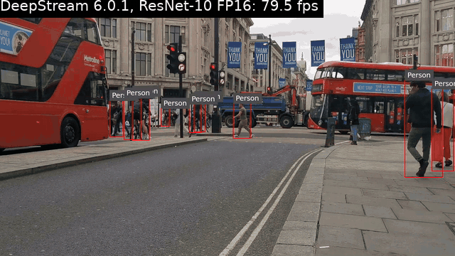

# DeepStream on the converted Nano

NVIDIA DeepStream 6.0.1 runs on a converted Nano, beside Ubuntu 26.04, as
an optional extra. It is not part of the converter and changes nothing of
the system it builds.

## What it is

DeepStream is NVIDIA's video analytics toolkit: GStreamer elements that
decode video on the video engines, batch the streams, run TensorRT models
on the GPU, track objects and draw the results. Version 6.0.1, from
JetPack 4.6, is the last one built for the Nano's GPU. The versions that
match JetPack 5's CUDA 11.4 and TensorRT 8.5 (DeepStream 6.2 and 6.3) are
built for Xavier and Orin only.

DeepStream 6.0.1 needs JetPack 4's whole user space: Ubuntu 18.04's
libraries and GStreamer 1.14, L4T R32.7's driver, EGL and video libraries,
CUDA 10.2, cuDNN 8.2 and TensorRT 8.2. This project's kernel runs JetPack
4's libraries ([patches/jp5](../patches/jp5/README.md)), so DeepStream gets
that user space whole: an Ubuntu 18.04 folder with NVIDIA's own JetPack 4.6
packages, entered with `chroot`. In short, **DeepStream runs on the Nano
under Ubuntu 26.04 and its kernel, but from a JetPack 4 environment, not
on Ubuntu 26.04's own libraries.**



<sub>`install-deepstream.sh --video` on the same stock clip from
[Pexels](https://www.pexels.com) as the README's YOLO picture: NVIDIA's
sample ResNet-10 detector, which knows four classes (a bus counts as a
car). The GIF plays at the clip's speed; 79.5 frames a second is how fast
the Nano ran the whole pipeline, decoding to encoding, on this clip
(2026-11-27).</sub>

## Measured

On the project's Nano, 2026-11-27, with `deepstream-app` on NVIDIA's
sample clip (`sample_1080p_h264.mp4`, 1,443 frames): hardware decoding,
streams batched at 1280x720, the sample ResNet-10 detector in FP16 with
batch 1, boxes drawn and hardware H.264 encoding to a file, with no
playback timing (the sink's `sync=0`). Two runs: the experiment this extra
came from, and
[install-deepstream.sh](../scripts/jetson/deepstream/install-deepstream.sh)
as published here, from an empty folder to its check.

| | Experiment | Fresh install |
| --- | --- | --- |
| Frames a second, last 5 s (average) | 86.1 (85.5) | 78.5 (77.9) |
| Frames with detections | 1,442 of 1,443 | 1,442 of 1,443 |
| Objects | 17,743 | 17,748 |
| Cars, people, bicycles, road signs | 14,053, 3,555, 133, 2 | 14,060, 3,553, 133, 2 |
| Check's time, TensorRT engine build included | (engine built earlier) | 123 s |

Why the second run was slower is not known; it was not repeated.

## Install

You need a converted Nano, 10 GiB free and internet. On the Nano, in this
repository:

```bash
cd scripts/jetson/deepstream
sudo bash install-deepstream.sh
```

It builds the folder at `/opt/nano-ds601` (about 5 GB, with about 2.5 GB of
downloads from Ubuntu and NVIDIA; you accept NVIDIA's terms), installs the
launcher `nano-deepstream`, and checks DeepStream on NVIDIA's sample clip.
The last line is `DEEPSTREAM_INSTALL=PASS` or `FAIL`, and
`~/deepstream-check/<time>/out.mp4` is the clip with the boxes drawn. The
first check builds the TensorRT engine, which takes a few minutes. Add
`--video clip.mp4` to check on an H.264 MP4 of your own.

## Use

```bash
sudo nano-deepstream deepstream-app -c my-config.txt
sudo nano-deepstream gst-inspect-1.0 nvinfer
sudo nano-deepstream bash        # a shell in DeepStream's folder
```

The folder you run it from is visible at the same path when it is under
`/home`, `/mnt` or `/media`, so configuration files, models and videos
there work as they are. Files DeepStream writes there belong to root.
NVIDIA's samples and configurations are at
`/opt/nano-ds601/opt/nvidia/deepstream/deepstream-6.0/samples`. In a
pipeline started in the background, give `deepstream-app` `< /dev/null`:
it reads the keyboard, and a background program that does is stopped.

## Remove

```bash
sudo bash uninstall-deepstream.sh
```

It removes the folder and the launcher, and names the tools the installer
took from Ubuntu's archive (debootstrap, curl, gpg) if it installed any.

## What the folder needed on this system

Each of these was found on the Nano, and the scripts set them all:

- The linker's folders as JetPack 4 sets them (`tegra`, `tegra-egl`) and
  DeepStream's own `lib`.
- `/dev/fb0` beside `tegra_dc`: JetPack 4's `libnvdc` opens both, and
  without `fb0` every NVIDIA buffer library crashed on load.
- NVIDIA's EGL only. GStreamer's GL library brings Mesa's EGL into the
  folder, and with both offered NVIDIA's buffer libraries crashed in
  Mesa's, which has no `/dev/dri` here.
- `GST_PLUGIN_PATH` naming DeepStream's plugin folder.
- `nvidia-l4t-init`, which NVIDIA's EGL package depends on.

`NvRmPrivGetChipPlatform: Could not read platform information` is printed by
every JetPack 4 library on this kernel and means nothing.

## Safety

The [rules](SAFETY.md) hold: the module's boot flash and the card's boot
partitions are never written.

- NVIDIA's bootloader and kernel packages are pinned out of the folder,
  and the installer checks they are absent.
- NVIDIA's flag for JetPack 4 packages in containers
  (`.nv-l4t-disable-boot-fw-update-in-preinstall`) is set.
- Three JetPack 4 packages write the flash when installed or started
  ([SAFETY.md](SAFETY.md)). NVIDIA's EGL package depends on one of them,
  `nvidia-l4t-init`, so the folder holds it, and the installer lists which
  of the three are there. In the folder they cannot reach the flash: there
  is no service manager to start them, its `/dev` holds only the GPU,
  display and video nodes (no disk or flash device), its `/sys` is
  read-only, and its programs cannot make device nodes, mount, use raw I/O
  or load kernel modules (`nano-deepstream` drops those capabilities).
- Downloads are checked: Ubuntu 18.04 by debootstrap against Ubuntu's
  archive keyring, NVIDIA's packages by apt against NVIDIA's key, whose
  fingerprint the installer checks.

The folder runs Ubuntu 18.04 and JetPack 4.6's libraries, which get no
security updates from Ubuntu's standard support, and DeepStream runs as
root. Use it for video you trust.

## Not tested

- The tracker (`nvtracker` loads; no run used it), more than one stream,
  and a window on the screen (`nveglglessink`).
- Cameras: USB through DeepStream, and CSI cameras, which the 5.10 device
  tree has switched off.
- DeepStream's Python bindings, its messaging parts (Kafka, AMQP, Redis,
  Azure, whose libraries the folder lacks) and Triton.
